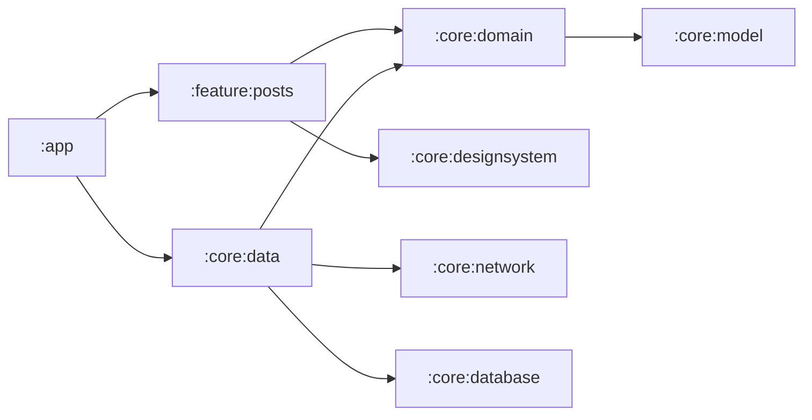

# Android Clean Architecture Template


A production-style **multi-module Android starter** that I use as the base for new apps.
It shows how I structure large codebases: strict layer boundaries, shared build logic,
offline-first data, and tests at every layer.

> One small feature (a list of posts from a public API, cached in Room) runs through
> every layer so the whole architecture can be seen end to end.

<!-- Add a screenshot or GIF here: docs/screenshot.png -->

## Architecture



| Module | Type | Responsibility |
|---|---|---|
| `core:model` | Pure Kotlin | Domain models, no framework code |
| `core:domain` | Pure Kotlin | Repository contracts + use cases |
| `core:data` | Android lib | Offline-first repository (Room = single source of truth) |
| `core:network` | Android lib | Retrofit + kotlinx.serialization |
| `core:database` | Android lib | Room entities and DAOs |
| `core:designsystem` | Android lib | Theme and shared Compose components |
| `feature:posts` | Feature | Screen + ViewModel (MVVM, unidirectional state) |
| `build-logic` | Included build | Gradle **convention plugins** shared by all modules |

### Rules the structure enforces
- `domain` and `model` are **pure Kotlin (JVM) modules**, so Android types can't leak into business logic.
- Features depend on `domain`, **never on `data`**. Only `:app` wires the implementation in through Hilt.
- Each module's build file is 3–10 lines. Shared setup lives in `build-logic/convention`.

## Tech stack
Kotlin · Jetpack Compose (Material 3) · Hilt · Coroutines/Flow · Room · Retrofit ·
kotlinx.serialization · Navigation Compose · JUnit · Turbine · detekt · GitHub Actions

## Run it
```bash
git clone https://github.com/namdevlondhe/android-clean-arch-template.git
cd android-clean-arch-template
./gradlew :app:installDebug      # run on a device or emulator
./gradlew detekt test            # static analysis and unit tests
```
Requires JDK 17 and Android Studio Ladybug or newer.

## Tests
| Layer | Test | What it checks |
|---|---|---|
| Domain | `ObservePostsUseCaseTest` | Business rule (sort order) |
| Data | `OfflineFirstPostRepositoryTest` | Network → DB sync, keeps cache on failure |
| UI | `PostsViewModelTest` | UI state for success and error paths |

## Using it for a new project
1. Rename the package `dev.namdev.template` and `applicationId`.
2. Copy `feature/posts` to `feature/<your-feature>` and apply `template.android.feature`.
3. Add the module to `settings.gradle.kts` and its navigation graph to `MainActivity`.

## License
MIT
